> I am a full-stack developer dedicated to building scalable, practical web applications with a strong focus on clean user experience. My expertise spans across frontend technologies like React and TypeScript, robust backend systems using Node.js and Python, and seamless deployment workflows.

**<samp>[Lumina](https://luminamentalwellnessplatform.vercel.app)</samp>** &nbsp;·&nbsp; <samp>React, TypeScript, Node.js, Socket.IO, Gemini</samp> 
<samp>A mental wellness app where you talk to an AI by voice in real time. It also has mood tracking with charts, daily tasks made by AI, and community chat.</samp>  

**<samp>[Present! – Smart Attendance](https://smart-attendance-system-black.vercel.app)</samp>** &nbsp;·&nbsp; <samp>Python, Flask, face_recognition, React</samp> 
<samp>Attendance with face recognition. A webcam or a class photo marks students present. Teachers get dashboards and reports, and students can check in with their own face.</samp>  

**<samp>[AmongUS for Coders](https://github.com/Himanshu-MlSHRA/AmongUS)</samp>** &nbsp;·&nbsp; <samp>React, Node.js, Socket.IO</samp> 
<samp>A multiplayer coding game. Players write code together in one live editor while secret imposters try to break it, then everyone votes them out.</samp>  

